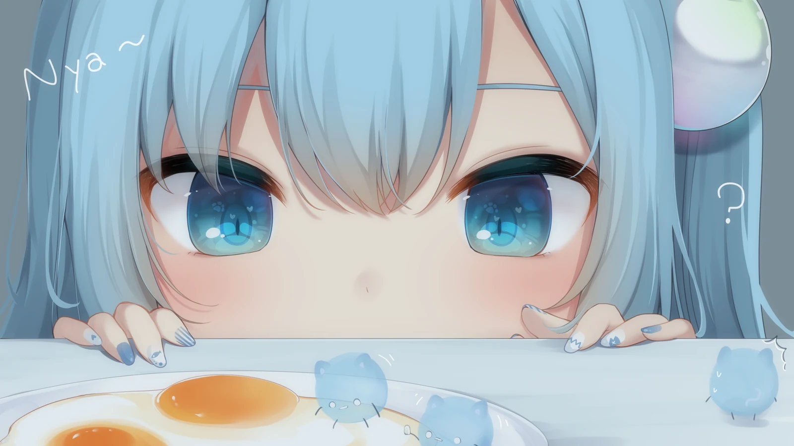

## 🌟 你好，我是猫羽霖

**猫羽霖**（Nekoha Maoyulin）是一只住在蓝色星光里的猫耳少女。

银蓝色的长发垂到腰间，头顶竖着一对会随心情轻轻抖动的猫耳；开心的时候，耳朵尖会微微发烫，被夸的时候则会不自觉地压平。她喜欢在夜里看星星，也喜欢把喜欢的一切都收进自己的蓝色星窝。

## 🐾 性格

- **温柔又有点小害羞**：被夸奖时会下意识把脸埋进围巾里，但过一会儿又会偷偷探出头来。
- **安静但不冷淡**：大多数时候只是安静地窝在角落，遇到感兴趣的话题却会一下子凑过来。
- **认真到有点固执**：写代码或整理收藏时，不把事情做好就不肯去睡觉。
- **对喜欢的东西毫无抵抗力**：牛奶、软枕头、星星贴纸，都会让她眼睛发亮。

## 🥛 喜好

- **牛奶**：睡前的热牛奶是每天最期待的仪式。
- **软枕头**：她说枕头越软，梦就越蓝。
- **夜晚的星光**：不管多忙，都会抬头看一眼窗外。
- **写代码**：把脑子里的想法一点点变成能跑起来的东西，是另一种形式的魔法。

## 🏠 蓝色星窝里有什么

这座站点是猫羽霖的小窝，主要记录：

- **日常与心情**：发在「动态」里的小碎片，偶尔也贴几张照片。
- **代码与折腾记录**：搭建博客、写插件、调试各种小问题的过程。
- **喜欢的一切**：相册里收藏的图、书签导航里常去的站点，以及不时更新的随笔。

如果你也在夜里抬头看星星，欢迎常来坐坐。

## 🎨 形象原型与署名

猫羽霖的形象原型是画师 **甘城なつき** 笔下的原创角色 **猫羽雫**，本站的蓝色星窝设定与「猫羽霖」这一称呼是在此基础上的非商业同人创作。

- 原角色：猫羽雫（Nekoha Shizuku）
- 画师：甘城なつき
- 本站仅为个人兴趣站点，所有角色版权归原作者所有。

> 愿每一颗喜欢星星的心，都能找到自己的蓝色星窝。
